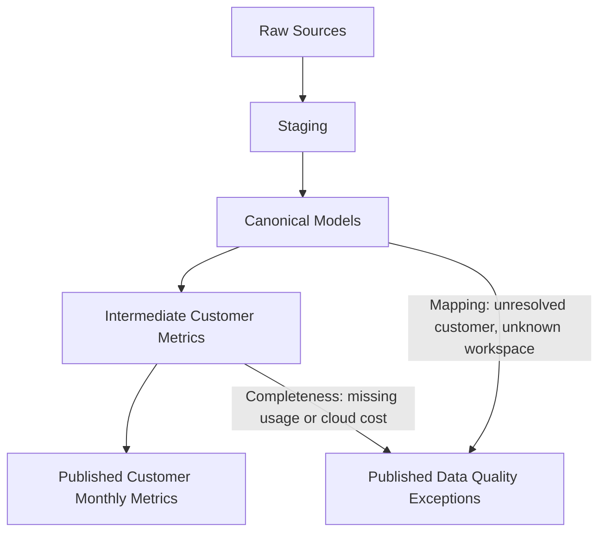

# Northstar Warehouse Design

## 1. Final Customer Reporting View

`published.customer_monthly_metrics` is a **dbt table** with one row per customer per eligible reporting month, including historical months. A customer-month is published only when customer attribution is resolved, subscription metrics are reliable, and every active workspace has valid usage and cloud-cost records for that month. Incomplete customer-months are excluded without affecting other customers.

Annualized subscription value is based on contracts effective at month-end, while usage, cloud costs, and estimated revenue reflect activity during the month. The `reporting_month` column identifies that period, and all monetary values are in USD.

Both published tables are fully rebuilt on each run. This keeps the pipeline simple and repeatable for the current dataset. As data volume grows, dbt supports moving to incremental processing without changing the published schema or metric definitions, provided updates and historical corrections are handled correctly.

```sql
CREATE TABLE published.customer_monthly_metrics (
    customer_id VARCHAR NOT NULL,
    customer_name VARCHAR,
    reporting_month DATE NOT NULL,
    annualized_subscription_value_usd DECIMAL(18,2),
    monthly_subscription_revenue_usd DECIMAL(18,2),
    product_usage_active_users BIGINT,
    product_usage_api_calls BIGINT,
    cloud_cost_usd DECIMAL(18,2),
    gross_margin DECIMAL(18,4)
);
```

| Column | Definition |
| --- | --- |
| `customer_id` | Customer ID from the normalized `accounts.account_id`. |
| `customer_name` | Customer name from `accounts.account_name`. |
| `reporting_month` | First day of the reporting month. Together with `customer_id`, uniquely identifies each row. |
| `annualized_subscription_value_usd` | Sum of annualized values of all distinct contracts active at month-end, including overlapping contracts. Monthly amounts are multiplied by 12; annual amounts are used as-is. Contracts that ended before month-end or start afterward are excluded. |
| `monthly_subscription_revenue_usd` | Sum of each distinct contract's estimated revenue for its active service days during the month, including overlapping contracts. |
| `product_usage_active_users` | Sum of observed active-user counts across the customer's workspaces for the month. Users active in multiple workspaces may be counted more than once. |
| `product_usage_api_calls` | Total observed API calls across the customer's workspaces for the month. |
| `cloud_cost_usd` | Observed compute and storage costs from all valid, selected, distinct charges attributed to the customer's workspaces for the month. Unallocated costs are tracked in `published.monthly_data_quality_exceptions`. |
| `gross_margin` | Percentage of estimated subscription revenue remaining after observed cloud costs: (`monthly_subscription_revenue_usd` − `cloud_cost_usd`) / `monthly_subscription_revenue_usd` × 100. Null when revenue is zero or required inputs are unknown. Other costs of revenue are not included. |

**Metric rules**

- Keep contact emails and account notes out of both published tables to protect PII.
- **Monthly subscription revenue** is estimated from each contract's annualized value divided by 12, prorated for the days it provided service during the reporting month. Include contracts that ended during the month, even if they are no longer active at month-end.
- Prorate partial-month starts and ends using inclusive service dates. Count days from the later of the contract start or month-start through the earlier of the contract end or month-end. Treat a missing contract end date as month-end. Sum the contract amounts by customer, then round to cents.
- Group metrics by customer and reporting month. All four business questions can be answered directly from `published.customer_monthly_metrics`, without joining to the exceptions table.
- Start reporting each customer from their earliest reliable contract start or associated workspace creation date. Continue reporting after subscriptions end or are cancelled. Do not use account `updated_at` as a creation date.
- **Customer-month eligibility:** Publish a month within the source-derived reporting cutoff only when subscription metrics are reliable, customer attribution is resolved, and every known workspace active during that month has at least one valid, selected record for both usage and cloud costs. A workspace is active if it was created by month-end and was not deleted before month-start.
- If a customer-month fails validation, exclude it and record the reason in `published.monthly_data_quality_exceptions`. Missing usage or cost data is not treated as zero, although confirmed zero activity or no eligible contracts may produce zero values. Gross margin is null when revenue is zero or cannot be calculated reliably.
- Keep unresolved mappings and unallocated costs visible without assigning them to customers arbitrarily or blocking unrelated customer-months.
- **Metric limitations:** Annualized subscription value is a month-end contract snapshot, while monthly subscription revenue is a prorated estimate, not recognized accounting revenue. Usage and cloud costs are observed values; workspace-month records establish coverage, but the source provides no independent evidence that all activity or charges were captured. Gross margin inherits the observed-cost limitation and is not a GAAP gross margin measure.
- **Aggregation limitations:** Customer-month values should not be treated as complete company-wide totals. Unallocated costs, unresolved mappings, and excluded customer-months may leave activity unrepresented.
- Do not sum annualized subscription value across months or sum or directly average gross-margin percentages. Active-user counts may overlap across workspaces or customers and do not represent distinct company-wide users. Company-level reporting would need its own aggregation and reconciliation rules.

`published.monthly_data_quality_exceptions` is a **dbt table**, retaining exceptions for both published and unpublished customer-months.

```sql
CREATE TABLE published.monthly_data_quality_exceptions (
    reporting_month DATE,
    source_table VARCHAR NOT NULL,
    issue_category VARCHAR NOT NULL,
    issue_reason VARCHAR NOT NULL,
    workspace_id VARCHAR,
    customer_id VARCHAR,
    source_row_id BIGINT,
    excluded_financial_amount_usd DECIMAL(18,2),
    excluded_active_users BIGINT,
    excluded_api_calls BIGINT
);
```

- `reporting_month` identifies the affected month; retain null when an invalid source date prevents determining it. Source table, available identifiers, and source-row ID support tracing the exception; missing-record exceptions have no source-row ID.
- Use `completeness` with `missing_usage` or `missing_cloud_cost` when an active workspace has no valid usage or cloud-cost records for the month. Use `mapping` with `unresolved_customer`, `unknown_workspace`, or `missing_workspace` for unresolved attribution. Unexpected invalid records fail dbt validation rather than being published as quarantine exceptions.
- Retain excluded customer-months with their specific reasons, along with unresolved usage and unallocated cloud costs.


## 2. Build, Recovery, and Verification

### 2.1 Build Execution and Example Queries

- `make build` initializes a queryable DuckDB warehouse from a clean checkout, builds all dbt models in dependency order, and runs the tests. Verify this with no existing warehouse: all expected tables must be created, required tests must pass, and published metrics must be queryable.
- `make queries` displays four labeled, single-`SELECT` examples against `published.customer_monthly_metrics`, without joins, data cleaning, or filtering unresolved records:
  1. Annualized subscription value by customer and reporting month.
  2. Product usage (active users and API calls) by customer and reporting month.
  3. Cloud cost by customer and reporting month.
  4. Gross margin by customer and reporting month.
- Document both commands and required prerequisites, including the supplied raw database, in the README so reviewers can reproduce the results.

### 2.2 Idempotency and Recovery

- Run the complete build twice against unchanged raw inputs and verify identical schemas, row counts, and table contents across all downstream tables, including the same reporting window regardless of execution date.
- Delete or truncate a downstream table, rerun the complete build, and verify correct restoration. Full rebuilds must not depend on previously materialized downstream contents; raw inputs remain unchanged.
- Unexpected invalid source records or duplicate normalized business keys cause `dbt build` to fail rather than being quarantined. Recovery requires correcting the input data and rerunning the build.

### 2.3 Source Integrity and Traceability

- Preserve `source_row_id` in staging and applicable canonical models to support tracing records back to the supplied DuckDB raw tables.
- Validate required fields and normalized business-key uniqueness using dbt tests. Unexpected invalid records or duplicate business keys fail the build rather than being quarantined.
- Preserve unresolved customer and workspace attribution through explicit resolution statuses and `published.monthly_data_quality_exceptions`.

### 2.4 Data-Quality Verification and Reconciliation

- Run dbt tests for uniqueness, non-null fields, relationships, accepted values, and essential business rules. Verify metric calculations, the source-derived reporting cutoff, valid usage and cloud-cost records for each active workspace and month, and absence of restricted PII.
- Reconcile observed usage and cloud-cost totals between canonical records and resolved/unresolved intermediate aggregates. Verify published values against eligible customer-month metrics without double-counting.

### 2.5 Publication Safeguards

- Fail `dbt build` when required-field, normalized business-key uniqueness, relationship, essential business-rule, metric-calculation, or PII-protection tests fail. Treat published tables as current only after a successful build; failed builds may leave stale or partially rebuilt tables available.
- Expected unresolved customer/workspace attribution remains visible through explicit resolution statuses and published exceptions without automatically failing the build.
- Exclude customer-months with incomplete usage or cloud-cost data, unresolved customer attribution, or unreliable subscription metrics. Record the specific reasons in `published.monthly_data_quality_exceptions` without affecting valid customer-months.

## 3. Transformation Pipeline

Raw Sources → Staging → Canonical Models → Intermediate Customer Metrics → Published Customer Monthly Metrics.



- Unexpected invalid records and duplicate normalized business keys fail dbt validation.
- Known unresolved mappings and missing usage or cloud-cost records for active workspace-months are represented in `published.monthly_data_quality_exceptions`.
- Restricted PII must not appear in analyst-accessible downstream tables.

### 3.1 Raw Sources

#### `raw.accounts` — CRM customers

| Field | Meaning |
| --- | --- |
| `account_id` | CRM customer identifier. |
| `account_name` | Customer name displayed in the final report. |
| `segment` | Customer category: Enterprise, Mid-market, or SMB. |
| `region` | Customer region: NA, EU, or APAC. |
| `primary_contact_email` | Contact email; sensitive. |
| `account_notes` | Free-text CRM notes; treat as sensitive. |
| `updated_at` | Account update timestamp stored as text. |

**Notes**

- Keep contact emails and account notes in access-restricted raw storage. Do not expose them in analyst-accessible staging, canonical, intermediate, or published tables. Free-text fields may contain PII even when no email address is present.
- Normalize account IDs consistently across all sources.
- Treat `updated_at` as the account's last-update timestamp, not its creation date. Rebuild downstream account models from the full `raw.accounts` dataset on each run, leaving the raw source unchanged.

#### `raw.contracts_batch1` — Subscription contracts

| Field | Meaning |
| --- | --- |
| `contract_id` | Subscription contract identifier. |
| `account_id` | CRM customer associated with the contract. |
| `plan` | Subscription plan: Enterprise, Growth, or Starter. |
| `billing_period` | Billing frequency: annual or monthly. |
| `recurring_amount_usd` | Recurring amount in USD for the billing period. |
| `starts_on` | Contract start date. |
| `ends_on` | Contract end date; missing means open-ended. |
| `status` | Contract status: active or cancelled. |
| `source_batch` | Identifier of the source extract. |
| `extracted_at` | Timestamp when the extract was produced. |

Notes:

- Trim whitespace from contract and customer IDs and convert them to uppercase. Normalize billing periods and statuses to lowercase.
- Parse amounts as decimals, service dates as dates, and extraction timestamps with timezone information. Validate amounts and date ranges before using them in calculations.
- Use contract service dates, not status alone, to determine eligibility. Annualized subscription value includes contracts active at month-end, while monthly subscription revenue includes all contracts providing service during the month, including cancelled contracts through their end date.

#### `raw.workspaces` — Product workspaces

| Field | Meaning |
| --- | --- |
| `workspace_id` | Product workspace identifier. |
| `workspace_name` | Workspace display name. |
| `crm_account_ref` | Account identifier linking the workspace to a CRM customer. |
| `created_at` | Workspace creation date stored as text. |
| `deleted_at` | Workspace deletion date; missing means no recorded deletion. |

Notes:

- Customer references contain lowercase and trailing-space differences, including `a-101` and `A-102 `.
- Some customer references are missing or do not match an account in `raw.accounts`, including W-307 (`A-999`) and W-308 (null).
- Creation and deletion dates are stored as text; a missing deletion date means no deletion is recorded.
- Workspace names are free text and may contain personal information; treat them as sensitive and keep them in access-restricted raw storage.

#### `raw.usage_batch1` — Monthly workspace usage

| Field | Meaning |
| --- | --- |
| `usage_id` | Usage record identifier. |
| `workspace_id` | Workspace associated with the usage. |
| `usage_month` | Reporting month, represented by its first day. |
| `active_users` | Workspace active-user count for the month. |
| `api_calls` | Workspace API-call count for the month. |
| `source_batch` | Identifier of the source extract. |
| `extracted_at` | Timestamp when the extract was produced. |

Notes:

- Usage and workspace identifiers are stored as text.
- Reporting months and extraction timestamps are stored as text and require date/timestamp parsing.
- Active-user and API-call counts are stored as text rather than numeric types.
- The provided extract contains April 2026 usage records for W-300 through W-308.
- Active-user counts are aggregated at workspace-month grain; the same person may be counted in multiple workspaces.

#### `raw.cloud_costs` — Monthly cloud costs

| Field | Meaning |
| --- | --- |
| `cost_id` | Cloud-cost record identifier. |
| `workspace_id` | Workspace associated with the cost; may be missing. |
| `usage_month` | Month the cost belongs to, represented by its first day. |
| `compute_cost_usd` | Compute cost in USD. |
| `storage_cost_usd` | Storage cost in USD. |
| `source_batch` | Identifier of the source extract. |
| `extracted_at` | Timestamp when the extract was produced. |

Notes:

- Cost and workspace identifiers are stored as text; workspace identifiers may be missing or reference unknown workspaces.
- Reporting months and extraction timestamps are stored as text. The reporting month identifies when costs were incurred, not when the extract was produced.
- Compute and storage costs are stored as text rather than decimal types.
- The provided extract includes K-508 with no workspace ID and K-509 referencing unknown workspace W-999.
- Cost records contain separate compute and storage amounts; multiple cost records may belong to the same workspace-month.


### 3.2 Staging

**Shared validation rules**

- All five staging models are dbt **tables**, rebuilt each run. Preserve every raw source record in its corresponding staging model without silently filtering records.
- Derive `source_row_id` from DuckDB’s internal `rowid` for traceability within the supplied database. It is not guaranteed to remain stable if a raw table is recreated.
- Normalize identifiers by trimming whitespace and standardizing case as specified in each transformation table.
- Use dbt tests to validate required fields, normalized business-key uniqueness, data types, and applicable business rules.
- Unexpected invalid records and duplicate normalized business keys fail `dbt build`; they are not quarantined.
- Missing or unknown customer/workspace references remain explicit unresolved mapping outcomes where permitted, rather than staging validation failures.
- **PII protection and residual risks:** Contact emails, account notes, and workspace names are treated as sensitive and excluded from analyst-accessible downstream models. Raw data access must be restricted. Personal information may still appear in customer names or identifiers, or be exposed through logs, debugging, or direct raw database access.
- Failed upstream tests prevent selected dependent models from running. Previously materialized published tables may remain available but are not guaranteed to be current.

#### `staging.stg_accounts`

One row per source record from `raw.accounts`.

```sql
CREATE TABLE staging.stg_accounts (
    source_row_id BIGINT NOT NULL,
    account_id VARCHAR NOT NULL,
    account_name VARCHAR NOT NULL,
    segment VARCHAR,
    region VARCHAR,
    updated_at TIMESTAMP WITH TIME ZONE
);
```

| Source column | Staging column | Transformation |
| --- | --- | --- |
| Internal DuckDB `rowid` | `source_row_id` | Preserve the raw row reference for this supplied database. |
| `account_id` | `account_id` | Trim whitespace, convert to uppercase, and treat empty values as null. |
| `account_name` | `account_name` | Trim whitespace and treat empty values as null. |
| `segment` | `segment` | Trim whitespace and treat empty values as null. |
| `region` | `region` | Trim whitespace, convert to uppercase, and treat empty values as null. |
| `primary_contact_email` | — | Excluded: PII. |
| `account_notes` | — | Excluded: PII. |
| `updated_at` | `updated_at` | Parse as a timezone-aware timestamp; invalid or empty values become null. |

**dbt tests and validations**

- `not_null`: `source_row_id`, `account_id`, `account_name`; `unique`: `account_id`, `source_row_id`.

#### `staging.stg_contracts`

One row per source record from `raw.contracts_batch1`.

```sql
CREATE TABLE staging.stg_contracts (
    source_row_id BIGINT NOT NULL,
    contract_id VARCHAR NOT NULL,
    account_id VARCHAR,
    plan VARCHAR,
    billing_period VARCHAR NOT NULL,
    recurring_amount_usd DECIMAL(18,2) NOT NULL,
    starts_on DATE NOT NULL,
    ends_on DATE,
    status VARCHAR NOT NULL,
    source_batch VARCHAR,
    extracted_at TIMESTAMP WITH TIME ZONE
);
```

| Source column | Staging column | Transformation |
| --- | --- | --- |
| Internal DuckDB `rowid` | `source_row_id` | Preserve the raw DuckDB row reference. |
| `contract_id` | `contract_id` | Trim whitespace, convert to uppercase, and treat empty values as null. |
| `account_id` | `account_id` | Trim whitespace, convert to uppercase, and treat empty values as null. |
| `plan` | `plan` | Trim whitespace and treat empty values as null. |
| `billing_period` | `billing_period` | Trim whitespace, convert to lowercase, and treat empty values as null. |
| `recurring_amount_usd` | `recurring_amount_usd` | Parse as a decimal with two fractional digits; invalid or empty values become null. |
| `starts_on` | `starts_on` | Parse as a date; invalid or empty values become null. |
| `ends_on` | `ends_on` | Parse as a date; empty values become null, while invalid nonempty values are flagged. |
| `status` | `status` | Trim whitespace, convert to lowercase, and treat empty values as null. |
| `source_batch` | `source_batch` | Preserve the original value. |
| `extracted_at` | `extracted_at` | Parse as a timezone-aware timestamp; invalid or empty values become null. |

**Row validation**

- Missing contract IDs, invalid/negative amounts, invalid service dates, end dates before start dates, and cancelled contracts without end dates fail dbt validation. A blank end date is valid for active contracts; an unparseable end date is not.
- Accept `annual`/`monthly` billing periods and `active`/`cancelled` statuses; other values fail dbt validation because their metric treatment is undefined.
- Missing or unmatched account references remain unresolved.

**dbt tests and validations**

- `not_null`: `source_row_id`, `contract_id`, `billing_period`, `recurring_amount_usd`, `starts_on`, `status`; `unique`: `contract_id`, `source_row_id`.
- `accepted_values`: billing period = annual/monthly; status = active/cancelled.
- Custom checks: nonnegative amount, valid service-date order, and an end date for cancelled contracts.

#### `staging.stg_workspaces`

One row per source record from `raw.workspaces`.

```sql
CREATE TABLE staging.stg_workspaces (
    source_row_id BIGINT NOT NULL,
    workspace_id VARCHAR NOT NULL,
    crm_account_ref VARCHAR,
    created_at DATE NOT NULL,
    deleted_at DATE
);
```

| Source column | Staging column | Transformation |
| --- | --- | --- |
| Internal DuckDB `rowid` | `source_row_id` | Preserve the raw DuckDB row reference. |
| `workspace_id` | `workspace_id` | Trim whitespace, convert to uppercase, and treat empty values as null. |
| `workspace_name` | — | Excluded: free text may contain PII. |
| `crm_account_ref` | `crm_account_ref` | Trim whitespace, convert to uppercase, and treat empty values as null. |
| `created_at` | `created_at` | Parse as a date; invalid or empty values become null. |
| `deleted_at` | `deleted_at` | Parse as a date; empty values become null, while invalid nonempty values are flagged. |

**Row validation**

- Missing workspace IDs, invalid creation/deletion dates, and deletion dates before creation dates fail dbt validation. A blank deletion date is valid; an unparseable date is not.
- Missing or unknown customer references remain unresolved; do not require a match to `raw.accounts` during staging validation.

**dbt tests and validations**

- `not_null`: `source_row_id`, `workspace_id`, `created_at`; `unique`: `workspace_id`, `source_row_id`.
- Custom check: `deleted_at` is null or on/after `created_at`.

#### `staging.stg_usage`

One row per source record from `raw.usage_batch1`.

```sql
CREATE TABLE staging.stg_usage (
    source_row_id BIGINT NOT NULL,
    usage_id VARCHAR NOT NULL,
    workspace_id VARCHAR,
    usage_month DATE NOT NULL,
    active_users BIGINT NOT NULL,
    api_calls BIGINT NOT NULL,
    source_batch VARCHAR,
    extracted_at TIMESTAMP WITH TIME ZONE
);
```

| Source column | Staging column | Transformation |
| --- | --- | --- |
| Internal DuckDB `rowid` | `source_row_id` | Preserve the raw DuckDB row reference. |
| `usage_id` | `usage_id` | Trim whitespace, convert to uppercase, and treat empty values as null. |
| `workspace_id` | `workspace_id` | Trim whitespace, convert to uppercase, and treat empty values as null. |
| `usage_month` | `usage_month` | Parse as a date and normalize to the first day of the month; invalid or empty values become null. |
| `active_users` | `active_users` | Parse as a nonnegative whole number; reject fractional, invalid, or out-of-range values. |
| `api_calls` | `api_calls` | Parse as a nonnegative whole number; reject fractional, invalid, or out-of-range values. |
| `source_batch` | `source_batch` | Preserve the original value. |
| `extracted_at` | `extracted_at` | Parse as a timezone-aware timestamp; invalid or empty values become null. |

**Row validation**

- Normalize valid `usage_month` values to the first day of the month.
- Validate counts as nonnegative whole numbers before casting; fractional, invalid, negative, or out-of-range values fail dbt validation.
- Missing required usage IDs or invalid months fail dbt validation.
- Keep missing or unmatched workspace references for explicit unresolved mapping downstream.

**dbt tests and validations**

- `not_null`: `source_row_id`, `usage_id`, `usage_month`, `active_users`, `api_calls`; `unique`: `source_row_id` and normalized (`workspace_id`, `usage_month`) for records with a workspace ID.
- Custom checks: nonnegative counts and first-of-month `usage_month`.

#### `staging.stg_cloud_costs`

One row per source record from `raw.cloud_costs`.

```sql
CREATE TABLE staging.stg_cloud_costs (
    source_row_id BIGINT NOT NULL,
    cost_id VARCHAR NOT NULL,
    workspace_id VARCHAR,
    usage_month DATE NOT NULL,
    compute_cost_usd DECIMAL(18,2) NOT NULL,
    storage_cost_usd DECIMAL(18,2) NOT NULL,
    source_batch VARCHAR,
    extracted_at TIMESTAMP WITH TIME ZONE
);
```

| Source column | Staging column | Transformation |
| --- | --- | --- |
| Internal DuckDB `rowid` | `source_row_id` | Preserve the raw DuckDB row reference. |
| `cost_id` | `cost_id` | Trim whitespace, convert to uppercase, and treat empty values as null. |
| `workspace_id` | `workspace_id` | Trim whitespace, convert to uppercase, and treat empty values as null. |
| `usage_month` | `usage_month` | Parse as a date and normalize to the first day of the month; invalid or empty values become null. |
| `compute_cost_usd` | `compute_cost_usd` | Parse as a decimal with two fractional digits; invalid or empty values become null. Reject values that cannot be represented exactly to two decimal places. |
| `storage_cost_usd` | `storage_cost_usd` | Parse as a decimal with two fractional digits; invalid or empty values become null. Reject values that cannot be represented exactly to two decimal places. |
| `source_batch` | `source_batch` | Preserve the original value. |
| `extracted_at` | `extracted_at` | Parse as a timezone-aware timestamp; invalid or empty values become null. |

**Row validation**

- Missing required fields, malformed reporting months, and invalid/negative financial amounts fail dbt validation.
- Reject compute or storage costs with more than two nonzero decimal places rather than silently rounding them. Trailing zeros are permitted; for example, `12.340` is valid, but `12.345` is not.
- Normalize valid cost months to the first day of the month.
- Preserve missing or unknown workspace IDs and their unallocated cost amounts for downstream mapping exceptions.
- Allow multiple legitimate cost records for the same workspace and reporting month.

**dbt tests and validations**

- `not_null`: `source_row_id`, `cost_id`, `usage_month`, `compute_cost_usd`, `storage_cost_usd`; `unique`: `source_row_id`.
- Custom checks: nonnegative compute/storage costs and first-of-month `usage_month`.

### 3.3 Canonical Models

#### `canonical.dim_customer`

dbt **table**, rebuilt each run from `staging.stg_accounts`. One row per validated customer; `customer_id` is the logical primary key. Each validated staging account maps directly to one canonical customer.

```sql
CREATE TABLE canonical.dim_customer (
    customer_id VARCHAR NOT NULL,
    customer_name VARCHAR NOT NULL,
    segment VARCHAR,
    region VARCHAR,
    updated_at TIMESTAMP WITH TIME ZONE,
    source_row_id BIGINT NOT NULL
);
```

**Transformation rules**

- Rename `account_id` to `customer_id` and `account_name` to `customer_name`. Preserve `segment`, `region`, `updated_at`, and `source_row_id`.
- Keep restricted PII, including contact emails and account notes, out of the dimension.

**dbt tests and validations**

- Staging enforces normalized `account_id` uniqueness and required-field validity.
- `not_null`: `customer_id`, `customer_name`, `source_row_id`; `unique`: `customer_id` and `source_row_id`.
- `relationships`: `source_row_id` references `staging.stg_accounts`. Custom lineage check: staging `account_id` equals canonical `customer_id`.
- Verify restricted PII is excluded. Fail `dbt build` on required-field, uniqueness, lineage, or PII-protection violations. Dependent models selected in the same build are skipped when upstream tests fail. Previously built published tables may remain available but may be stale.

#### `canonical.dim_workspaces`

dbt **table**, rebuilt each run directly from `staging.stg_workspaces`. One row per validated workspace; `workspace_id` is the logical primary key.

```sql
CREATE TABLE canonical.dim_workspaces (
    workspace_id VARCHAR NOT NULL,
    created_at DATE NOT NULL,
    deleted_at DATE,
    source_row_id BIGINT NOT NULL
);
```

**Transformation rules**

- Preserve `workspace_id`, `created_at`, `deleted_at`, and `source_row_id` from each staging workspace.
- Retain workspaces with missing or unknown customer references for resolution in `canonical.map_customer_workspaces`; customer references remain in staging.
- Keep restricted PII, including workspace names, out of the dimension.

**dbt tests and validations**

- Staging enforces normalized `workspace_id` uniqueness and required-field validity.
- `not_null`: `workspace_id`, `created_at`, `source_row_id`; `unique`: `workspace_id` and `source_row_id`.
- `relationships`: `source_row_id` references `staging.stg_workspaces`. Custom lineage check: the staging row has the same workspace ID, creation date, and deletion date as the canonical row.
- Check that `deleted_at` is null or on/after `created_at`.
- Fail `dbt build` on required-field, uniqueness, lineage, lifecycle, or PII-protection violations. Missing or unknown customer references do not fail validation solely because attribution is unresolved. Dependent models selected in the same build are skipped when upstream tests fail. Previously built published tables may remain available but may be stale.


#### `canonical.map_customer_workspaces`

dbt **table**, rebuilt each run from `canonical.dim_workspaces` and `canonical.dim_customer`, using customer references from `staging.stg_workspaces`. One row per workspace; `workspace_id` is the logical primary key. A customer can own multiple workspaces; a workspace has at most one resolved customer.

```sql
CREATE TABLE canonical.map_customer_workspaces (
    workspace_id VARCHAR NOT NULL,
    customer_id VARCHAR,
    resolution_status VARCHAR NOT NULL
);
```

**Transformation rules**

- Use `canonical.dim_workspaces` as the workspace list. Retrieve each workspace’s normalized `crm_account_ref` from `staging.stg_workspaces` by workspace ID, preserving source traceability.
- Left join the customer reference to `canonical.dim_customer.customer_id`, preserving workspaces with missing or unmatched references.
- Set `resolution_status` to `resolved` and populate `customer_id` on a match. Otherwise, set `unresolved_customer` and leave `customer_id` null.
- Keep restricted PII, including workspace names, emails, and notes, out of the model.

**dbt tests and validations**

- `not_null`: `workspace_id`, `resolution_status`; `unique`: `workspace_id`; `accepted_values`: status = resolved/unresolved_customer.
- `relationships`: workspace ID references `dim_workspaces`; nonnull customer ID references `dim_customer`. Resolved rows require a customer ID; unresolved rows require null.
- Verify every canonical workspace appears exactly once and assignments match its staging customer reference and the resolution rules above.
- Fail `dbt build` when mapping integrity, required-field, uniqueness, relationship, or resolution tests fail. Unresolved customer attribution alone does not fail the build. Dependent models selected in the same build are skipped when upstream tests fail. Previously built published tables may remain available but may be stale.

#### `canonical.fct_contracts`

dbt **table**, rebuilt each run directly from `staging.stg_contracts`, with customer attribution from `canonical.dim_customer`. One row per validated contract; `contract_id` is the logical primary key.

```sql
CREATE TABLE canonical.fct_contracts (
    contract_id VARCHAR NOT NULL,
    customer_id VARCHAR,
    resolution_status VARCHAR NOT NULL,
    plan VARCHAR,
    billing_period VARCHAR NOT NULL,
    recurring_amount_usd DECIMAL(18,2) NOT NULL,
    starts_on DATE NOT NULL,
    ends_on DATE,
    status VARCHAR NOT NULL,
    source_batch VARCHAR,
    extracted_at TIMESTAMP WITH TIME ZONE,
    source_row_id BIGINT NOT NULL
);
```

**Transformation rules**

- Preserve each staging contract’s identifiers, financial fields, service dates, status, batch metadata, extraction timestamp, and `source_row_id`.
- Left join `account_id` to `canonical.dim_customer.customer_id`. On a match, populate `customer_id` and set `resolution_status` to `resolved`; otherwise, leave `customer_id` null and use `unresolved_customer`. Preserve contracts with missing or unknown customer references.
- Contract start and end dates are inclusive. Retain cancelled, ended, and future contracts in the fact table.
- Support annual and monthly billing periods. Distinct valid contracts contribute additively, including when service dates overlap, under the existing annualized subscription value and estimated monthly revenue rules.

**dbt tests and validations**

- Staging validates normalized `contract_id` uniqueness, required fields, financial values, billing periods, statuses, and service dates.
- `not_null`: `contract_id`, `resolution_status`, `billing_period`, `recurring_amount_usd`, `starts_on`, `status`, `source_row_id`; `unique`: `contract_id` and `source_row_id`.
- `accepted_values`: resolution = `resolved`/`unresolved_customer`; billing period = `annual`/`monthly`; status = `active`/`cancelled`. Validate nonnegative amounts, service-date order, and required end dates for cancelled contracts.
- Validate nonnull customer IDs against `dim_customer` and source-row lineage and attributes against `stg_contracts`. Verify customer attribution matches the staging `account_id`; resolved rows require a customer ID and unresolved rows require null.
- Invalid contracts, duplicate normalized contract IDs, or lineage/attribution violations fail `dbt build` and skip selected downstream dependencies. Unresolved customer attribution alone does not fail the build.

#### `canonical.fct_workspace_usage`

dbt **table**, rebuilt each run from `staging.stg_usage`, with customer attribution from `canonical.map_customer_workspaces`. One row per validated workspace-month usage record; records without a workspace ID remain individually identifiable by `usage_id` and `source_row_id`.

```sql
CREATE TABLE canonical.fct_workspace_usage (
    usage_id VARCHAR NOT NULL,
    workspace_id VARCHAR,
    customer_id VARCHAR,
    resolution_status VARCHAR NOT NULL,
    usage_month DATE NOT NULL,
    active_users BIGINT NOT NULL,
    api_calls BIGINT NOT NULL,
    source_batch VARCHAR,
    extracted_at TIMESTAMP WITH TIME ZONE,
    source_row_id BIGINT NOT NULL
);
```

**Transformation rules**

- Preserve each staging record’s usage and workspace identifiers, `usage_month`, `active_users`, `api_calls`, batch metadata, extraction timestamp, and `source_row_id`, without aggregation or discarding unresolved records.
- Left join `workspace_id` to `canonical.map_customer_workspaces`. Use `resolved` when the workspace maps to a known customer, `unresolved_customer` when it exists without a resolved customer, `unknown_workspace` when a nonnull ID has no canonical workspace, and `missing_workspace` when the ID is null. Populate `customer_id` only for resolved records.
- Preserve unresolved usage for `published.monthly_data_quality_exceptions`; never assign it to another customer’s usage totals.
- Keep historical usage for deleted workspaces, using the current workspace mapping for customer attribution.

**dbt tests and validations**

- Staging validates normalized workspace-month uniqueness where a workspace ID exists, valid reporting months, and nonnegative usage counts.
- `not_null`: `usage_id`, `resolution_status`, `usage_month`, `active_users`, `api_calls`, `source_row_id`; `unique`: `usage_id`, `source_row_id`, and (`workspace_id`, `usage_month`) where workspace ID is nonnull.
- `accepted_values`: `resolved`, `unresolved_customer`, `missing_workspace`, `unknown_workspace`. Check nonnegative counts and first-of-month usage dates.
- Validate source-row lineage and usage values against `stg_usage`, customer relationships, and mapping status. Only resolved records have a nonnull `customer_id`.
- Invalid records, duplicate normalized workspace-month keys, or lineage/attribution consistency violations fail `dbt build`. Expected unresolved workspace/customer attribution alone does not fail the build.

#### `canonical.fct_workspace_cloud_costs`

dbt **table**, rebuilt each run from `staging.stg_cloud_costs`, with customer attribution from `canonical.map_customer_workspaces`. One row per validated source cloud-cost record; multiple charges can belong to the same workspace and month.

```sql
CREATE TABLE canonical.fct_workspace_cloud_costs (
    cost_id VARCHAR NOT NULL,
    workspace_id VARCHAR,
    customer_id VARCHAR,
    resolution_status VARCHAR NOT NULL,
    usage_month DATE NOT NULL,
    compute_cost_usd DECIMAL(18,2) NOT NULL,
    storage_cost_usd DECIMAL(18,2) NOT NULL,
    source_batch VARCHAR,
    extracted_at TIMESTAMP WITH TIME ZONE,
    source_row_id BIGINT NOT NULL
);
```

**Transformation rules**

- Preserve each staging record’s cost and workspace identifiers, `usage_month`, compute/storage amounts, batch metadata, extraction timestamp, and `source_row_id`. Keep exact financial amounts without rounding or dropping records during attribution.
- Retain multiple legitimate charges for the same workspace-month; do not deduplicate or aggregate by workspace and month.
- Left join `workspace_id` to `canonical.map_customer_workspaces`. Use `resolved` when the workspace maps to a known customer, `unresolved_customer` when it exists without a resolved customer, `unknown_workspace` when a nonnull ID has no canonical workspace, and `missing_workspace` when the ID is null. Populate `customer_id` only for resolved records.
- Preserve unresolved costs for `published.monthly_data_quality_exceptions`; never assign them to another customer’s cloud-cost totals.
- Keep historical costs for deleted workspaces, using the current workspace mapping for customer attribution.

**dbt tests and validations**

- `not_null`: `cost_id`, `resolution_status`, `usage_month`, `compute_cost_usd`, `storage_cost_usd`, `source_row_id`; `unique`: `cost_id` and `source_row_id`. Workspace IDs may be null; workspace-month keys need not be unique.
- `accepted_values` for `resolution_status`: `resolved`, `unresolved_customer`, `missing_workspace`, `unknown_workspace`. Check nonnegative costs, exact two-decimal financial precision, and first-of-month usage dates.
- Validate source-row lineage and exact amounts against `stg_cloud_costs`, customer relationships, and mapping status. Only resolved records have a nonnull `customer_id`.
- Reconcile staging compute/storage totals against resolved and unresolved canonical charges without double-counting.
- Invalid source records or integrity, lineage, attribution-consistency, or reconciliation violations fail `dbt build`. Expected unresolved attribution alone does not fail the build.

### 3.4 Intermediate Customer Metrics

#### `intermediate.int_customer_subscription_metrics`

dbt **table**, rebuilt each run from `canonical.dim_customer`, `canonical.fct_contracts`, `canonical.dim_workspaces`, and `canonical.map_customer_workspaces`, using reporting months from `staging.stg_usage` and `staging.stg_cloud_costs`. One row per customer and month; (`customer_id`, `reporting_month`) is the logical primary key.

```sql
CREATE TABLE intermediate.int_customer_subscription_metrics (
    customer_id VARCHAR NOT NULL,
    reporting_month DATE NOT NULL,
    annualized_subscription_value_usd DECIMAL(18,2) NOT NULL,
    monthly_subscription_revenue_usd DECIMAL(18,2) NOT NULL
);
```

**Transformation rules**

- Set the reporting cutoff to the latest valid `usage_month` present in both `staging.stg_usage` and `staging.stg_cloud_costs`. Match months only, not workspace IDs. Use source data, not the build date; if no common month exists, fail validation with a clear error. Check workspace-month usage/cost record coverage separately for customer-month publication.
- Generate reporting months from the earliest known contract start or mapped workspace creation through the source-derived cutoff. Include each customer beginning with their earliest reliable contract start or mapped workspace creation.
- Calculate annualized subscription value (ASV) at month-end. Sum all distinct annual contract amounts unchanged and monthly contract amounts multiplied by 12. Include overlapping contracts additively when effective on the final day of the month, using inclusive start/end dates. Contracts that ended before month-end contribute zero to ASV.
- Calculate monthly subscription revenue independently. For each contract, divide its annualized amount by 12, multiply by active service days within the reporting month, and divide by calendar days in that month. Sum distinct contract contributions by customer/month before rounding to two decimal places. Include overlapping contracts additively and cancelled contracts through their inclusive end dates.
- Aggregate resolved contracts by customer/month before joining to the customer/month spine. Use zero when no eligible contracts exist, but not for missing or unreliable contract data.
- Include only contracts with `resolution_status = 'resolved'`; never assign unresolved contracts to another customer. Unresolved attribution alone does not fail the model, but affected totals are unreliable when those contracts could change them.

**dbt tests and validations**

- `not_null`: all columns; `unique`: (`customer_id`, `reporting_month`); `relationships`: `customer_id` references `canonical.dim_customer`.
- Check nonnegative amounts, two-decimal monetary precision, and first-of-month reporting dates. Verify the defined cutoff, including failure when no common month exists, and spine coverage for every applicable customer/month.
- Validate ASV against month-end eligible contracts and revenue against service-day proration, including partial months and customers without eligible contracts. Verify joins do not multiply contract amounts.
- Fail `dbt build` on integrity, calculation, uniqueness, or contract-consistency violations.

#### `intermediate.int_customer_monthly_usage`

dbt **table**, rebuilt each run from `canonical.fct_workspace_usage`, using the customer/month spine from `intermediate.int_customer_subscription_metrics`. One row per customer and reporting month with resolved usage records; (`customer_id`, `reporting_month`) is the logical primary key.

```sql
CREATE TABLE intermediate.int_customer_monthly_usage (
    customer_id VARCHAR,
    resolution_status VARCHAR NOT NULL,
    reporting_month DATE NOT NULL,
    product_usage_active_users BIGINT NOT NULL,
    product_usage_api_calls BIGINT NOT NULL
);
```

**Transformation rules**

- Include only canonical usage with `resolution_status = 'resolved'` for customer/months in the subscription metrics spine.
- Group by `customer_id` and `usage_month`, using `usage_month` as `reporting_month`. Sum `active_users` and `api_calls` across the customer’s workspaces and set `resolution_status` to `resolved`.
- Usage totals reflect observed records. Active users are additive workspace counts, not distinct people across workspaces.
- Preserve observed zero counts, but do not generate synthetic zero-usage rows when records are missing. Aggregation does not prove coverage across all active workspaces; downstream completeness and publication safeguards still apply.
- Leave unresolved usage in the canonical fact for reporting through `published.monthly_data_quality_exceptions`; do not include it in customer totals or assign it to placeholder customers.

**dbt tests and validations**

- `not_null`: all columns; `unique`: (`customer_id`, `reporting_month`).
- `relationships`: `customer_id` references `canonical.dim_customer`; `accepted_values` for `resolution_status`: `resolved`.
- Check nonnegative counts and first-of-month reporting dates. Verify customer/months belong to the subscription metrics spine.
- Validate aggregated counts against contributing resolved canonical usage, without multiplying counts through joins or creating zeros for missing records.
- Fail `dbt build` on integrity, uniqueness, or aggregation violations. Unresolved attribution alone does not fail the build.

#### `intermediate.int_customer_monthly_cloud_costs`

dbt **table**, rebuilt each run from `canonical.fct_workspace_cloud_costs`, using the customer/month spine from `intermediate.int_customer_subscription_metrics`. One row per customer and reporting month; (`customer_id`, `reporting_month`) is the logical primary key.

```sql
CREATE TABLE intermediate.int_customer_monthly_cloud_costs (
    customer_id VARCHAR,
    resolution_status VARCHAR NOT NULL,
    reporting_month DATE NOT NULL,
    cloud_cost_usd DECIMAL(18,2)
);
```

**Transformation rules**

- Include only canonical charges with `resolution_status = 'resolved'`. Aggregate by `customer_id` and `usage_month` before left joining to the customer/month spine; set `resolution_status` to `resolved`.
- Sum `compute_cost_usd + storage_cost_usd` into `cloud_cost_usd`. Include every valid attributed charge, including multiple charges for the same workspace-month, without deduplicating by workspace and month. Preserve exact two-decimal precision.
- Preserve observed zero costs. When no matching cost records exist, retain `NULL`; do not generate synthetic zero-cost rows. Observed totals do not establish complete workspace coverage; downstream completeness and publication safeguards still apply.
- Exclude `unresolved_customer`, `unknown_workspace`, and `missing_workspace` charges from customer totals. Preserve them in the canonical fact for `published.monthly_data_quality_exceptions`; do not assign unallocated costs to placeholder customers.

**dbt tests and validations**

- `not_null`: `customer_id`, `resolution_status`, `reporting_month`; `unique`: (`customer_id`, `reporting_month`).
- `relationships`: `customer_id` references `canonical.dim_customer`; `accepted_values` for `resolution_status`: `resolved`.
- Check nonnegative nonnull costs, exact two-decimal precision, and first-of-month reporting dates. Verify customer/month coverage matches the subscription metrics spine.
- Validate totals against contributing resolved canonical charges without multiplying amounts through joins. Verify missing costs remain `NULL`.
- Fail `dbt build` on integrity, uniqueness, precision, or aggregation violations. Unresolved attribution alone does not fail the build.

### 3.5 Published Customer Reporting View

#### `published.customer_monthly_metrics`

dbt **table**, rebuilt each run; one row per resolved customer per eligible reporting month. Analysts can query the published metrics directly without additional joins or handling unresolved records.

```sql
CREATE TABLE published.customer_monthly_metrics (
    customer_id VARCHAR NOT NULL,
    customer_name VARCHAR,
    reporting_month DATE NOT NULL,
    annualized_subscription_value_usd DECIMAL(18,2),
    monthly_subscription_revenue_usd DECIMAL(18,2),
    product_usage_active_users BIGINT,
    product_usage_api_calls BIGINT,
    cloud_cost_usd DECIMAL(18,2),
    gross_margin DECIMAL(18,4)
);
```

**Transformation rules**

- Start from `intermediate.int_customer_subscription_metrics`. Left join `intermediate.int_customer_monthly_usage` and `intermediate.int_customer_monthly_cloud_costs` by customer ID and reporting month, and left join `canonical.dim_customer` by customer ID for customer names. Include all eligible historical customer-months.
- Preserve month-end annualized subscription value, prorated service-period estimated monthly revenue, observed usage, and attributed cloud costs from the intermediate models, with existing monetary precision.
- Require at least one valid usage and cloud-cost record for every known workspace mapped to the customer and active during the reporting month. A workspace is active when created on/before month-end and not deleted before month-start. Check canonical workspace-level records; aggregate totals alone do not establish coverage. Refer to Section 1 for metric limitations.
- Exclude customer-months with missing required usage or cloud-cost records, unresolved customer attribution affecting their reliability, or unreliable subscription metrics. Record specific reasons in `published.monthly_data_quality_exceptions`; unrelated attribution issues must not block valid customer-months.
- Omitted customer-months are unreportable, not zero. Withholding the entire row may withhold otherwise valid metrics; this is intentional because dependent metrics such as gross margin require reliable revenue and cost inputs.
- Gross margin dollars equal estimated monthly revenue minus cloud cost. Calculate the published `gross_margin` percentage as `(monthly_subscription_revenue_usd - cloud_cost_usd) / monthly_subscription_revenue_usd * 100`, rounded to four decimal places. Return null when revenue is zero or required inputs are unknown.
- Exclude contact emails, account notes, workspace names, and other restricted PII.

**dbt tests and validations**

- `not_null`: `customer_id`, `reporting_month`; `unique`: (`customer_id`, `reporting_month`).
- `relationships`: `customer_id` references `canonical.dim_customer`.
- Verify customer names and metric values against the contributing intermediate models, including monetary precision and gross-margin calculations.
- Verify no ineligible customer-months are published and excluded customer-months have corresponding specific exceptions.
- Confirm joins do not duplicate customer-months or multiply amounts, and restricted PII is absent.

#### `published.monthly_data_quality_exceptions`

dbt **table**, rebuilt each run; the single analyst-facing table explaining excluded source records and customer-months, including exceptions for both published and unpublished customer-months.

```sql
CREATE TABLE published.monthly_data_quality_exceptions (
    reporting_month DATE,
    source_table VARCHAR NOT NULL,
    issue_category VARCHAR NOT NULL,
    issue_reason VARCHAR NOT NULL,
    workspace_id VARCHAR,
    customer_id VARCHAR,
    source_row_id BIGINT,
    excluded_financial_amount_usd DECIMAL(18,2),
    excluded_active_users BIGINT,
    excluded_api_calls BIGINT
);
```

**Transformation rules**

- Generate source-record `mapping` exceptions from canonical attribution outcomes: `unresolved_customer`, `unknown_workspace`, or `missing_workspace`. Preserve unresolved usage and unallocated cloud costs without assigning them to unrelated customers.
- Generate customer-month `completeness` exceptions from publication eligibility rules, including `missing_usage`, `missing_cloud_cost`, and existing specific reasons for unreliable subscription metrics.
- Preserve available source table, customer/workspace identifiers, reporting month, and `source_row_id`. Missing-record exceptions have null `source_row_id`; retain null reporting months when the affected month cannot be determined.
- Preserve applicable `excluded_financial_amount_usd`, `excluded_active_users`, and `excluded_api_calls`. Leave unknown or inapplicable values null; never invent zeros.

**dbt tests and validations**

- `not_null`: `source_table`, `issue_category`, `issue_reason`; accepted `issue_category` values: `mapping`, `completeness`.
- Validate issue reasons against their corresponding categories and publication eligibility rules.
- Check first-of-month dates when `reporting_month` is nonnull and nonnegative excluded amounts and usage counts when available.
- Verify source-row traceability against the contributing canonical record when `source_row_id` is available. Missing-record exceptions must not invent source-row IDs or missing amounts.
- Verify excluded customer-months have specific completeness exceptions and mapping exceptions agree with canonical attribution outcomes.
- Reconcile unresolved usage and cloud costs against canonical records; the supplied April dataset’s $773.00 unallocated cost is a verification reference, not hardcoded transformation logic.
- Confirm restricted PII is absent.

## 4. Future Considerations

- **Incremental loading:** Replace full rebuilds with incremental processing as data volume grows, using change detection, lookback windows, and targeted reprocessing.
- **SCD Type 2 dimensions:** Introduce dbt snapshots or equivalent history tracking to preserve customer and workspace attribute changes and support historical attribution.
- **Historical corrections:** Define whether late-arriving data and source corrections should restate previously published months or whether finalized reporting periods should be frozen, with a controlled adjustment process.
- **GAAP compliance:** Work with Finance to validate revenue recognition, cost allocation, and gross-margin definitions before treating contractual estimates as accounting-compliant financial metrics.
- **dbt Semantic Layer:** Define governed metrics centrally using dbt's semantic modeling capabilities, enabling BI tools and other consumers to query consistent business metrics without writing SQL.

## 5. Out of Scope Requirements

The initial implementation uses dbt validation rather than dedicated audit and quarantine workflows. Invalid source records and duplicate normalized business keys fail validation instead of being quarantined.

The following capabilities are deferred:

- **Staging:** Dedicated quarantine tables, rejected-record recovery, and row-level disposition tracking across accounts, contracts, workspaces, usage, and cloud costs.
- **Canonical:** Dedicated audit and quarantine tables, timestamp-based duplicate selection, superseded-record tracking, and historical workspace-mapping audits.
- **Pipeline verification:** Exhaustive source-row accounting and lineage reconciliation across raw, staging, audit, quarantine, and canonical layers.
- **Published exceptions:** Quarantine-related issue categories, rejection reasons, and publication of quarantined records.

Unresolved customer mappings, unattributed usage, unallocated cloud costs, and missing data coverage remain in scope and are reported through `published.monthly_data_quality_exceptions`.

## 6. Implementation Pull Requests

### PR 1 — Canonical Models

Implement the raw, staging, and canonical dbt models described in Section 3.

**Deliverables:**

- dbt source definitions with table and column documentation for all five raw sources.
- Staging models for accounts, contracts, workspaces, usage, and cloud costs, with dbt table and column documentation.
- Canonical customer, workspace, mapping, contract, usage, and cloud-cost models, with dbt table and column documentation.
- dbt tests for required fields, normalized identifier uniqueness, valid dates and values, and referential consistency.

**Acceptance criteria:**

- `make build` successfully loads the supplied data and builds the implemented models.
- Invalid source records and duplicate normalized business keys fail validation.
- Valid records with unresolved customer attribution are preserved for downstream exception reporting.
- Repeated builds produce consistent results.

### PR 2 — Business Queries

Implement the intermediate and published dbt models described in Section 3.

**Deliverables:**

- Intermediate customer-month subscription, usage, and cloud-cost metrics, with dbt table and column documentation.
- `published.customer_monthly_metrics` with subscription value, usage, cloud cost, and gross-margin metrics, with dbt table and column documentation.
- `published.monthly_data_quality_exceptions` with mapping and completeness exceptions, with dbt table and column documentation.
- Customer-month eligibility rules that exclude incomplete or unreliable metrics without affecting valid customer-months.
- dbt tests for aggregation accuracy, required fields, financial calculations, and publication eligibility.
- Example SQL queries, documentation, and `make queries` support.

**Acceptance criteria:**

- Analysts can query customer-month metrics without additional joins or cleaning logic.
- Unresolved attribution and excluded customer-months are visible in the exceptions table.
- Published financial and usage metrics reconcile with eligible intermediate records.
- `make build` and `make queries` complete successfully.
